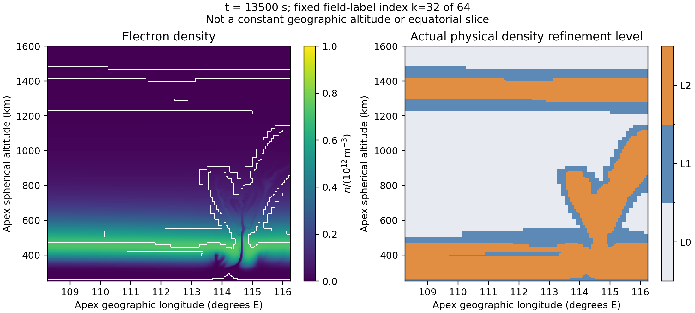

# ESF-IGRF-AMR

> **Performance development branch `perf/exact-cfl-work`.** The qualified code
> changes and measured timings are in [PERFORMANCE_UPDATE.md](docs/PERFORMANCE_UPDATE.md).
> The stable release/tag `v0.1.0` is preserved. Bundled methodology PDFs and
> their TeX remain the v0.1.0 artifacts; use the current Markdown function index
> and update note for this branch's execution changes.

An independent **C11 / MPI / optional OpenMP / PETSc** model for equatorial
spread F on traced dipole or IGRF-14 magnetic flux tubes. The model includes
conservative O+ transport, parallel momentum, a field-line-integrated
Pedersen/Hall potential equation and two- or three-level transverse AMR.
An experimental night-only option transports NO+ and O2+ and includes reactions
with common electron pressure.

This is a research/teaching implementation, not TELF source, an exact match to
every TELF numerical choice, or an event-calibrated Hong Kong forecast. Its
E-region closure is a physical population, not a numerical conductivity floor.
There is no physical density floor or velocity cap.

## Documentation

* [Build, run, MPI/OpenMP, Slurm and continuation](docs/RUNNING.md)
* [Every executable parameter and actual default](docs/PARAMETERS.md)
* [Geometry, physical/internal levels and AMR criteria](docs/GRID_AND_AMR.md)
* [Physics and complete stage/call sequence](docs/METHODS.md)
* [Outputs, units, shapes and checkpoint formats](docs/OUTPUTS.md)
* [Student reading guide / 学习路线](docs/LEARNING_GUIDE_ZH.md)
* [Every runtime function](docs/FUNCTIONS.md)
* [LaTeX methodology](methodology/main.tex), [methods PDF](methodology/main.pdf),
  [complete annotated-source atlas](methodology/source-atlas.pdf)
* [Validation and measured performance](docs/VALIDATION.md)
* [Performance audit and remaining bottlenecks](docs/PERFORMANCE_AUDIT.md)

## Build and first run

Install a C11 compiler, CMake >=3.18, MPI, pkg-config and **real double-precision
PETSc**. Qualification uses PETSc 3.26.1; MPI must match PETSc's MPI build.
Python 3 runs the launcher/checks; model evolution itself is C.

```sh
git clone --branch perf/exact-cfl-work --depth 1 https://github.com/ijmhd/ESF-IGRF-AMR.git
cd ESF-IGRF-AMR
pkg-config --modversion PETSc
cmake -S . -B build -DCMAKE_BUILD_TYPE=Release \
  -DESF_MPI=ON -DESF_PETSC=ON
cmake --build build -j 4
ctest --test-dir build --output-on-failure
python3 tools/run_case.py smoke --binary build/esf3d --ranks 1 --out runs/smoke
```

Set `PKG_CONFIG_PATH` to a custom PETSc prefix's `lib/pkgconfig` if necessary.
Complex and non-double PETSc configurations are rejected. See the build guide
for static PETSc dependencies and a non-MPI geometry/reference-only build.

The smoke case advances **0.2 s** to exercise interfaces and I/O. It is not a
bubble-development simulation. The other explicit teaching examples stop at
600 s by default:

```sh
python3 tools/run_case.py dipole --ranks 4 --out runs/dipole
python3 tools/run_case.py hk-amr2 --ranks 4 --out runs/hk-amr2
python3 tools/run_case.py hk-amr3 --ranks 4 --out runs/hk-amr3
python3 tools/run_case.py hk-night-demo --ranks 4 --out runs/night-demo
```

Use `--end 3600` for a longer **absolute model stop time** and `--dry-run` to
inspect the full command. A coarse teaching run is not guaranteed to resolve
branches or reproduce an observed depletion by a particular time. The night
demo has a deliberately synthetic neutral table, starts at 22 HKT, and is not
the large production background or a 20 MLT event.

## What grid dimensions mean

| Physical levels | User roots | Finest transverse cells | Along-field cells |
|---|---|---|---|
| Two: L0/L1 | N x M | 2N x 2M | `ns`, unchanged |
| Three: L0/L1/L2 | N x M | 4N x 4M | `ns`, unchanged |

The qualified large three-level case uses user roots **64 x 80 x 64** and
canonical geometry **256 x 320 x 64**, with apex-longitude centre 112.25 degrees
and span 8 degrees. Geographic longitude at Hong Kong/Sanya is not its tube's
apex longitude; determine observation coverage by actual tracing. Teaching cases
use much smaller grids. Read the grid guide before changing dimensions.

Density AMR is local in transverse coordinates and along-field slabs. Geometry
stays fixed; the electric-field mesh may extend farther along a tube than the
density mesh. NO+/O2+ still use the full canonical grid, so O+ active-cell savings
do not imply proportional memory or speed savings.

## Hybrid build

```sh
cmake -S . -B build-omp -DCMAKE_BUILD_TYPE=Release \
  -DESF_MPI=ON -DESF_PETSC=ON -DESF_OPENMP=ON
cmake --build build-omp -j 4
python3 tools/run_case.py hk-amr3 --binary build-omp/esf3d \
  --ranks 4 --threads 2 --out runs/hk-hybrid
```

Reserve at least `ranks * threads` CPUs and bind enough cores to each rank.
One-core rank binding defeats a four-worker run. MPI/PETSc calls stay on the
main thread. Independent molecular grid lines, chemistry cells, response refresh
and stage updates are threaded; AMR O+ face traversal remains on the main thread
because its lazy caches and coarse/fine writes require different ownership.

## Continuing a night run

Preserve the physical/AMR parameters and use a new output directory. Select a
complete native/molecular checkpoint pair from the same time:

```sh
python3 tools/run_case.py hk-night-demo --ranks 4 --end 1200 \
  --restart runs/night-demo/checkpoint_latest.bin \
  --night-restart runs/night-demo/night_state_latest.bin \
  --out runs/night-continued
```

Do not patch identities to bypass a failed check. Source edits, including
geometry comments, change strict fingerprints. A geometry cache is a native-ABI
performance file, distinct from a portable state checkpoint. The qualification
harness's audited rebinding of historical test copies is not a normal restart
workflow.

## Scope and evidence

The release compares full saved states and actual AMR labels over the same
13350-13500 s physical interval, output/checkpoints every 150 s. Reported timings
include initialization, output and actual MPI exit. Resource counts and limits
are in the validation guide; short tests are not extrapolated to 20000 s.

Temperatures/neutrals are prescribed. There is no energy equation, photoionization,
neutral-wind evolution, ion-ion momentum exchange or molecular perpendicular
pressure diffusion. Reaction momentum uses a fixed-neutral-bath approximation.
Collision multipliers and idealized profiles are documented explicitly. The night
module rejects modeled illuminated E-layer cells; UTC is not magnetic local time.



The saved13500s example is a fixed field-label-index slice against apex labels,
not an equatorial or geographic350km plane. White outlines separate actual
physical refinement levels. See the methods caption and figure provenance.

## License and citation

GPL-3.0: [LICENSE](LICENSE), [THIRD_PARTY.md](THIRD_PARTY.md),
[CITATION.cff](CITATION.cff). Official IGRF-14 coefficients and checksum are
included. PETSc/MPI are external dependencies. No TELF, Athena++ or SWMF source
is included. Record the tag, source identity, complete case and input hashes
with every result.
