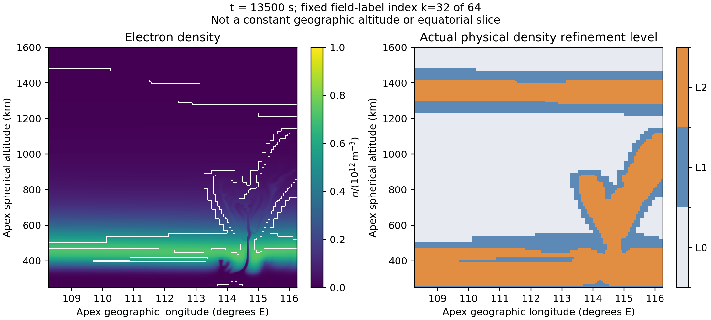
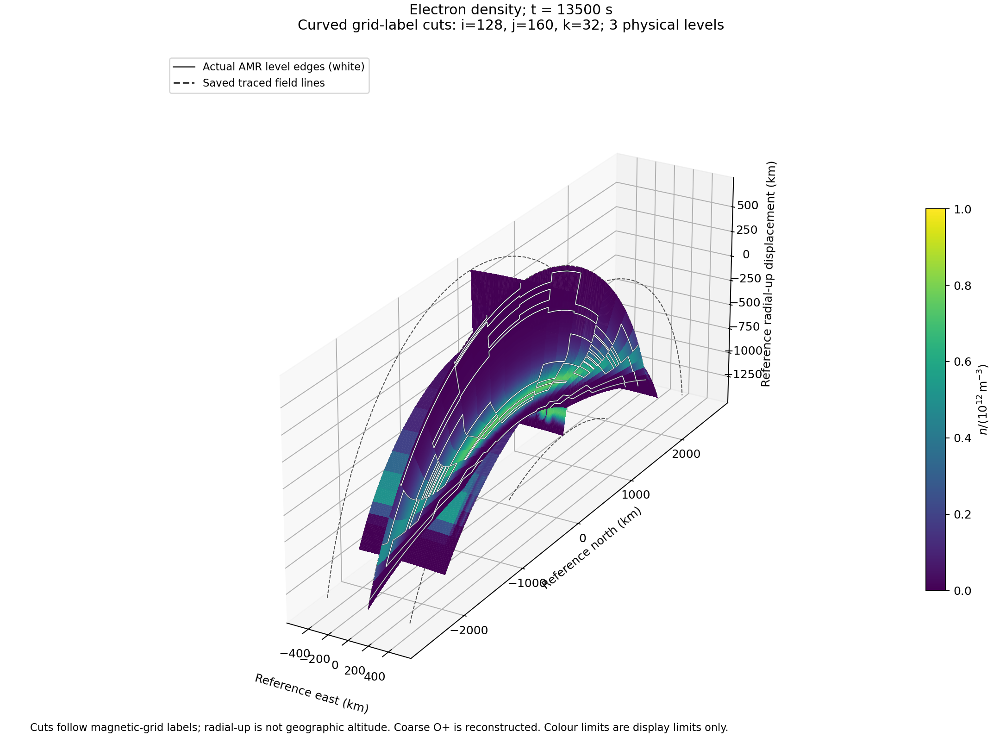

# 从下载源码到 ESF 模拟和绘图：完整中文教程

本页给出一条完整工作流：**下载 → 安装依赖 → 编译 → 检查 → 运行 → 修改算例与网格 → 续算 → 二维/三维切片 → 带 AMR 网格的 movie**。命令、参数文件、C 源码和 Python 绘图源码都在本仓库中，无需 TELF 源码。

本文的命令以 **Linux、Bash、MPI、实数双精度 PETSc** 为主。模型推进由 C11 完成，Python 负责算例展开和后处理。工作站可在本机运行；集群的编译、测试、模拟和数组绘图应在申请到的计算节点上进行。下文所有相对路径均以仓库根目录为起点，另有说明除外。

目录：

1. [下载与版本选择](#step-1)
2. [安装系统依赖、MPI 与 PETSc](#step-2)
3. [安装 Python 绘图环境与 FFmpeg](#step-3)
4. [编译模型和运行检查](#step-4)
5. [第一个能跑通的算例](#step-5)
6. [运行 dipole、香港 IGRF 和夜间算例](#step-6)
7. [修改物理参数、扰动、网格和 AMR](#step-7)
8. [MPI/OpenMP 与 Slurm 提交](#step-8)
9. [读懂输出和正确续算](#step-9)
10. [二维切片与清晰的 AMR 指示](#step-10)
11. [三维曲面切片与磁力线](#step-11)
12. [制作完整 movie](#step-12)
13. [源码在哪里、如何阅读和修改](#step-13)
14. [保存结果和排查问题](#step-14)
15. [本教程的验证范围与官方参考](#step-15)

<a id="step-1"></a>
## 1. 下载与版本选择

### 1.1 推荐：Git 下载

```bash
git clone --branch main https://github.com/ijmhd/ESF-IGRF-AMR.git
cd ESF-IGRF-AMR
export ESF_REPO="$PWD"
git branch --show-current
git rev-parse HEAD
```

`ESF_REPO` 保存仓库的绝对路径，便于后面安装依赖时切换目录。重新打开终端后，先 `cd` 到仓库，再执行 `export ESF_REPO="$PWD"`。

| 版本 | 用途 | 本教程与新绘图工具 |
|---|---|---|
| `main` | v0.1.0 数值核心，加上后续教程和绘图工具；适合教学入口 | 包含 |
| `perf/exact-cfl-work` | 已做独立配对验证的性能开发版本 | 同样包含 |
| `v0.1.0` tag | 原始冻结发布，用于精确对应随附的 LaTeX、PDF 与源码行号 | 不含冻结以后的新教程和三维/movie 工具 |

需要性能分支时，另建目录，避免混淆二进制和检查点：

```bash
cd ..
git clone --branch perf/exact-cfl-work \
  https://github.com/ijmhd/ESF-IGRF-AMR.git ESF-IGRF-AMR-perf
cd ESF-IGRF-AMR-perf
export ESF_REPO="$PWD"
```

性能修改的实现和测量范围见[性能分支说明](https://github.com/ijmhd/ESF-IGRF-AMR/blob/perf/exact-cfl-work/docs/PERFORMANCE_UPDATE.md)。**不要用切换分支后的新二进制直接读取原分支的夜间检查点**；源身份是严格校验的一部分。需要重复一项结果时，保存确切 commit，而不仅是会继续移动的分支名。

### 1.2 不使用 Git：下载 ZIP

下载 [main 源码 ZIP](https://github.com/ijmhd/ESF-IGRF-AMR/archive/refs/heads/main.zip)，解压后进入 `ESF-IGRF-AMR-main`，执行：

```bash
cd ESF-IGRF-AMR-main
export ESF_REPO="$PWD"
```

ZIP 包包含 C、头文件、测试、算例、IGRF 系数、绘图脚本和文档，但没有 Git 历史。记录下载日期、所选版本和 `validation/source_identity.json`。精确固定版本时，优先下载 GitHub 上指定 commit 的源码。

<a id="step-2"></a>
## 2. 安装系统依赖、MPI 与 PETSc

### 2.1 所需软件

| 软件 | 用途 |
|---|---|
| 支持 C11 的 C 编译器 | 编译物理和数值核心 |
| CMake ≥ 3.18、make、pkg-config | 配置、构建和寻找 PETSc |
| MPI 的编译包装器与启动器 | `mpicc`、`mpiexec`；必须与 PETSc 使用同一套 MPI |
| PETSc，实数、双精度 | 分布式电势方程和 AMR；本文固定源码安装示例为 3.26.1 |
| Python 3 | 启动算例、元数据检查、绘图 |
| NumPy、Matplotlib | 读取数组、绘图 |
| FFmpeg，可选 | PNG 帧编码为 MP4 |

Linux 是已验证的计算环境。Windows 用户可在 WSL2 的 Linux 环境内按本文操作。macOS 可以使用相应依赖，但系统 Clang 的 OpenMP 支持需另行安装；本页没有把这些平台称为已经完成完整模型验证的环境。

Ubuntu/Debian 工作站可先安装基础包。以下命令需要本机管理员权限；集群用户不要在登录节点执行系统安装：

```bash
sudo apt-get update
sudo apt-get install build-essential gfortran cmake git pkg-config \
  python3 python3-venv openmpi-bin libopenmpi-dev ffmpeg unzip
```

集群通常已有编译器、MPI 和 PETSc module。按本站说明加载一套彼此匹配的环境，避免同时加载两种 MPI。确认：

```bash
command -v mpicc
command -v mpiexec
mpicc --version
cmake --version
```

### 2.2 已有 PETSc：直接使用

把下方 `/absolute/path/to/petsc` 换成安装前缀；如果管理员已经配置好环境，则不必重复设置：

```bash
export PKG_CONFIG_PATH="/absolute/path/to/petsc/lib/pkgconfig:${PKG_CONFIG_PATH:-}"
export LD_LIBRARY_PATH="/absolute/path/to/petsc/lib:${LD_LIBRARY_PATH:-}"
pkg-config --modversion PETSc
pkg-config --cflags --libs PETSc
```

必须是 **real + double**。complex 或 single PETSc 会被本项目的 CMake 检查拒绝。`mpiexec`、`mpicc` 和 PETSc 链接的 MPI 必须一致；仅版本号相同并不能代替库的一致性。

### 2.3 没有 PETSc：安装到用户目录

下面是独立的源码安装示例；在集群上，应在计算资源分配内运行配置、编译和检查。它不替换系统 MPI：

```bash
export ESF_DEPS="$ESF_REPO/../esf-deps"
mkdir -p "$ESF_DEPS"
git clone --branch v3.26.1 --depth 1 \
  https://gitlab.com/petsc/petsc.git "$ESF_DEPS/petsc"
cd "$ESF_DEPS/petsc"

./configure PETSC_ARCH=arch-esf-opt \
  --prefix="$ESF_DEPS/petsc-install" \
  --with-cc=mpicc --with-cxx=mpicxx --with-fc=mpif90 \
  --with-debugging=0 --with-shared-libraries=1 \
  --with-scalar-type=real --with-precision=double \
  --download-fblaslapack

make PETSC_DIR="$PWD" PETSC_ARCH=arch-esf-opt all
make PETSC_DIR="$PWD" PETSC_ARCH=arch-esf-opt check
make PETSC_DIR="$PWD" PETSC_ARCH=arch-esf-opt install

cd "$ESF_REPO"
export PKG_CONFIG_PATH="$ESF_DEPS/petsc-install/lib/pkgconfig:${PKG_CONFIG_PATH:-}"
export LD_LIBRARY_PATH="$ESF_DEPS/petsc-install/lib:${LD_LIBRARY_PATH:-}"
pkg-config --modversion PETSc
```

`--download-fblaslapack` 需要 Fortran 编译器和构建节点网络。如果没有 Fortran，可改用 `--with-fc=0 --download-f2cblaslapack`，并删除原来的 `--with-fc=mpif90 --download-fblaslapack`。使用集群优化 BLAS/LAPACK 时，按管理员说明把下载选项替换为本站库配置；需要离线构建时参考 [PETSc 安装说明](https://petsc.org/release/install/install/)。

不要把上述配置片段混用成一套含有重复冲突选项的命令。PETSc 配置最终打印的 `make` 指令也是核对安装路径的依据。

<a id="step-3"></a>
## 3. Python 绘图环境与 FFmpeg

在仓库根目录创建独立环境：

```bash
cd "$ESF_REPO"
python3 -m venv .venv-plot
source .venv-plot/bin/activate
python -m pip install --upgrade pip
python -m pip install -r requirements-plot.txt
python -c 'import numpy, matplotlib; print(numpy.__version__, matplotlib.__version__)'
```

后面的 `python3` 应指向这个环境。重新登录后重新 `source .venv-plot/bin/activate`。集群可以使用管理员提供的 Python/NumPy/Matplotlib，绘图采用无显示器的 `Agg` 后端，不需要桌面或 X11。

检查视频编码器：

```bash
ffmpeg -version
```

没有 FFmpeg 时，切片和 PNG/PDF 序列仍然可以生成；movie 工具加 `--frames-only`。也可通过 `--ffmpeg /absolute/path/to/ffmpeg` 指向可执行文件。本文使用的 MP4 命令需要该 FFmpeg 提供 `libx264` 编码器。

<a id="step-4"></a>
## 4. 编译模型和运行检查

### 4.1 推荐的完整构建

以下构建同时支持 MPI、PETSc 和可选多线程内核。工作站直接运行；集群进入计算资源分配后运行：

```bash
cd "$ESF_REPO"
cmake -S . -B build \
  -DCMAKE_C_COMPILER=mpicc \
  -DCMAKE_BUILD_TYPE=Release \
  -DPython3_EXECUTABLE="$(command -v python3)" \
  -DESF_MPI=ON -DESF_PETSC=ON -DESF_OPENMP=ON
cmake --build build -j 4
ctest --test-dir build --output-on-failure
```

`-j 4` 表示编译并行度，不能超过分配给编译任务的 CPU 数。完整依赖和 Python 被检测到时，当前 CMake 注册 **10 项 CTest**。检查实际输出是否全部通过；不要只以可执行文件生成作为验收。

单独的迁移检查需要至少 8 个已分配 MPI 槽位，另行执行：

```bash
mpiexec -n 8 ./build/test_amr3_migration
```

它不是 `ctest` 自动执行的第十一项，也不属于每个小算例运行前都必须重复的操作。普通学生可先完成 CTest 和 smoke。

| CMake 开关 | 本文选择 | 含义 |
|---|---|---|
| `ESF_MPI` | ON | MPI 分解 |
| `ESF_PETSC` | ON | AMR 和分布式电势求解所需；其原始默认值是 OFF |
| `ESF_OPENMP` | ON | 线程化经过审计的独立内核，要求 MPI 和 PETSc |
| `ESF_SANITIZE` | OFF | 调试用地址/未定义行为检查，性能测量不要混用 |
| `CMAKE_BUILD_TYPE` | Release | 优化构建 |

若编译器没有 OpenMP，改用 `-DESF_OPENMP=OFF`，并把后续 `--threads` 设为 1。更换 MPI、编译器、PETSc 类型后，使用新的构建目录，不要沿用旧 CMake 缓存。

### 4.2 静态 PETSc 的额外链接依赖

若静态 PETSc 的依赖位于 pkg-config 的 `Libs.private` 中，可生成下面的完整包装器源码，再重新配置：

```bash
mkdir -p tmp
cat > tmp/pkg-config-static <<'SH'
#!/bin/sh
exec pkg-config --static "$@"
SH
chmod +x tmp/pkg-config-static
cmake -S . -B build-static \
  -DCMAKE_C_COMPILER=mpicc -DCMAKE_BUILD_TYPE=Release \
  -DESF_MPI=ON -DESF_PETSC=ON -DESF_OPENMP=ON \
  -DPKG_CONFIG_EXECUTABLE="$ESF_REPO/tmp/pkg-config-static"
cmake --build build-static -j 4
```

后续选择该构建时，给启动器传 `--binary build-static/esf3d`。不要通过删掉缺失的 BLAS/LAPACK/MPI 链接项使错误表面消失。

### 4.3 只检查 IGRF 和磁力线，不安装 PETSc

这个简化构建可用于学习几何，但不能运行下面的 AMR bubble 算例：

```bash
cmake -S . -B build-basic -DESF_MPI=OFF -DESF_PETSC=OFF
cmake --build build-basic -j 4
./build-basic/field_eval data/igrf14coeffs.txt 2025 22.3 114.2 350 13
./build-basic/tube_map data/igrf14coeffs.txt 2025 22.3 114.2 350 13 hk-line.csv
```

这里输入的是 WGS84 大地纬度/经度/高度，`field_eval` 输出北、东、向下磁场和模长（nT）；`tube_map` 写出目标所在共轭磁力线及 apex 信息。`hk-line.csv` 需要新文件名。

<a id="step-5"></a>
## 5. 第一个能跑通的算例

先只展开命令，不启动模型：

```bash
python3 tools/run_case.py smoke --binary build/esf3d \
  --ranks 1 --threads 1 --out runs/smoke --dry-run
```

确认路径和参数后，去掉 `--dry-run`：

```bash
python3 tools/run_case.py smoke --binary build/esf3d \
  --ranks 1 --threads 1 --out runs/smoke
```

模型输出到 `runs/smoke/`。正常退出后，应有 `metadata.json`、`completion.json`、`frames.csv`、`structure_frames.csv`、几何文件和每帧状态。这个算例只推进 **0.2 秒**，用于确认接口、求解、更新、AMR 和 I/O 能跑通；这个时间和网格不用于判断 bubble 是否充分生长。

检查完成时间和已存帧：

```bash
python3 - <<'PY'
import json
from pathlib import Path
root = Path('runs/smoke')
print(json.dumps(json.loads((root/'completion.json').read_text()), indent=2))
print((root/'frames.csv').read_text())
PY
```

一个目录只对应一次运行。重新运行时用 `runs/smoke-02`，不要删除先前输出或覆盖其元数据。

<a id="step-6"></a>
## 6. 运行 dipole、香港 IGRF 和夜间算例

每个示例的完整输入在 [examples](../examples)；实际启动参数由 [run_case.py](../tools/run_case.py) 打印。启动器不是物理模型。

| 名称 | 磁场 | 物理层数 | 用户 L0 网格 nx×ny×ns | 原始终止时间 | 用途 |
|---|---|---|---|---|---|
| `smoke` | aligned dipole | 3 | 4×4×16 | 0.2 s | 安装与接口检查 |
| `dipole` | aligned dipole | 2 | 16×20×32 | 600 s | 理想化演化 |
| `hk-amr2` | IGRF-14 | 2 | 16×20×32 | 600 s | 香港区域几何、两级 AMR |
| `hk-amr3` | IGRF-14 | 3 | 16×20×32 | 600 s | 相同区域、三级 AMR |
| `hk-night-demo` | IGRF-14 | 2 | 16×20×32 | 600 s | 合成中性背景下的夜间分子离子模块 |

例如在已分配至少 4 个 CPU 的环境内：

```bash
python3 tools/run_case.py dipole --ranks 4 --out runs/dipole
python3 tools/run_case.py hk-amr2 --ranks 4 --out runs/hk2
python3 tools/run_case.py hk-amr3 --ranks 4 --out runs/hk3
python3 tools/run_case.py hk-night-demo --ranks 4 --out runs/night
```

这些是可分开执行的算例，不需要全部跑完才能画图。先选择 `hk-amr3` 就可以完成本文的 IGRF+AMR 工作流。

延长一个**新运行**的终止时间：

```bash
python3 tools/run_case.py hk-amr3 --ranks 4 --end 3600 --out runs/hk3-long
```

`--end 3600` 是模型相对初始时刻的绝对终止时间。600 s 示例没有承诺形成分叉；3600 s 也不是所有背景下一定分叉的时钟。要研究增长、泡壁与分叉，需要合适的物理背景、驱动、扰动和分辨率，不能只靠延长时间或增加 AMR 层数。

`hk-night-demo` 使用仓库中的**合成**高度中性表，起始 UTC 为 2025-03-20 14:00，即 **22:00 HKT**，不等于 20 MLT。它不是生产长算的输入，也不是某次观测事件的拟合。非夜间示例仍有明确的物理 E 层电导闭合贡献；不能把 `--E-peak` 随意改成零。

<a id="step-7"></a>
## 7. 修改参数、扰动、网格和 AMR

### 7.1 三种默认值不要混淆

1. 可执行程序未指定参数时的默认值，见 [PARAMETERS.md](PARAMETERS.md)，共 79 项。
2. `examples/*.json` 显式指定的教学参数，可能覆盖可执行默认值。
3. 某次生产或验证的有效输入，只适用于该次运行。

例如教学 JSON 显式使用 `--cfl .25`、`--pdm-beta 1`、`--exb-scheme pdm4`、`--rtol 1e-10`。这些参数在启动命令中可见，不能用短帮助文本推断完整输入。

### 7.2 网格维度到底是什么

横向坐标是**磁力线 apex 经度和 apex 球面高度**；第三维沿整根共轭磁力线。模型不是一个以香港为中心的经纬高直角盒子。

| 设置 | 用户 L0 | 内部 roots | 最细 canonical 横向网格 | 沿场 |
|---|---|---|---|---|
| `--amr-levels 2` | nx×ny | nx×ny | 2nx×2ny | ns |
| `--amr-levels 3` | nx×ny | 2nx×2ny | 4nx×4ny | ns |

因此示例 `16×20×32` 在三级时对应 canonical **64×80×32**。`ns` 不会因为三级 AMR 变成 128；本实现只做横向二分，可以在不同沿场 slab 中选择不同密度级别。

- `--lon-deg 112.25 --span-deg 8`：apex 经度中心及总宽度，范围 108.25–116.25°E。
- `--apex-min-km 250 --apex-max-km 1600`：磁通管 apex 球面高度范围，不是全域所有单元高度范围。
- `--base-km 90`：两端共轭 E 层底部球面高度。
- `--ns 32 --amr-slab-cells 4`：沿场 32 段，每 4 段一组密度标记；slab 大小必须整除 ns。

三亚、香港是否在域内，要把实际大地位置通过 `tube_map` 映射为 apex 标签并检查沿场位置，不能只比较城市地理经度与 apex 经度范围。球面高度和 WGS84 大地高度也不同。[GRID_AND_AMR.md](GRID_AND_AMR.md) 给出完整几何与层级约定。

### 7.3 常用物理与数值控制

| 参数 | CLI 单位/设置 | 改变什么 |
|---|---|---|
| `--field` | `igrf` / `dipole` / `aligned-dipole` | 分别是 IGRF degree13、实际 degree1、轴对齐理想 dipole |
| `--year` | 十进制年份 | IGRF 系数年代，与 UTC 时钟分开 |
| `--background-profile` | `single` / `telf` | 指定背景 Chapman 剖面 |
| `--E-peak` | m^-3 | 物理 E 层初始人口；非夜间固定，夜间作为分子离子初值 |
| `--amplitude` | 分数 | 初始密度扰动幅度；示例 .15 表示 15% |
| `--seed-lon-deg` | apex 经度 | 扰动的 apex 经度位置 |
| `--seed-height-km` | km | 球面高度方向的扰动中心 |
| `--seed-width-km` | km | 垂直包络宽度 |
| `--seed-east-km` | km | 水平包络宽度；不是向东移动的距离 |
| `--temperature-sum` | K | 固定 Ti+Te；夜间需等于 chem-Ti+chem-Te |
| `--background-east-mVm` | mV/m | 外加向东电场；会改变物理驱动 |
| `--electric-driver` | CSV 路径 | time_s,east_V_m 时变驱动，须覆盖绝对终止时间 |
| `--parallel-flux` | `relaxation` / `rusanov` | 沿场通量；夜间要求 relaxation |
| `--parallel-order` | 1 / 2 | 沿场重构，与横向 PDM4 分开 |
| `--exb-scheme` | `pdm4` / `muscl` | 横向通量重构 |
| `--pdm-beta` | 无量纲 | PDM 限幅参数，示例为 1；不是另一套 alpha |
| `--cfl`、`--dt-max` | 无量纲、秒 | 稳定性限制和最大步长 |
| `--rtol` | 无量纲 | 电势真实残差验收尺度 |
| `--output-every` | 秒 | 帧及检查点输出间隔，不是模拟时间步 |
| `--max-steps` | 步数 | 包含续算历史的绝对步数上限 |

驱动、边界、夜间温度、中性表及周期性之间有约束，不能只改一项而忽略 [完整参数表](PARAMETERS.md) 的 interactions。`--year` 不会自动设置当地时间、中性背景、太阳活动或 20 MLT。

### 7.4 AMR 如何跟着泡壁、尖端和分叉

示例使用局部结构探测，而非无条件对整条磁力线取 OR：

| 参数 | 示例值 | 作用 |
|---|---|---|
| `--amr-mode` | dynamic | 允许随解细化和回粗；fixed/none/fine 含义见网格文档 |
| `--amr-levels` | 2 或 3 | 物理级别数；不是“在根网格之上再加 3 次” |
| `--amr-criteria` | structure | 梯度、曲率、速度及信息损失结构判据 |
| `--amr-density-indicator` | represented | 探测时扣除可表示的局部背景形状，避免仅因背景梯度全域加密 |
| `--amr-gradient-on/off` | .125 / .0625 | 泡壁梯度的细化/保留阈值 |
| `--amr-curve-on/off` | .02 / .01 | 尖端和分叉曲率的细化/保留阈值 |
| `--amr-velocity-on` | .1 | 漂移曲率的细化请求 |
| `--amr-sigma-on` | .05 | 积分电导张量曲率引起的电场网格请求 |
| `--amr-buffer` | 1 | 请求周围横向 root-cell 缓冲 |
| `--amr-interval` | 30 s | 最大标记检查间隔；累计移动可提前触发 |
| `--amr-quiet-seconds` | 60 s | 回粗前安静时间和最短驻留，减少来回跳级 |
| `--amr-seed-guard` | 0 | 本组教学/晚期验证的显式选择 |

早期弱扰动需要保护时，显式启用 seed guard 并给出真实的最短扰动波长；详情见网格文档。`--amr-seed-amplitude` 是保护判据参数，不等于初始化密度的 `--amplitude`。AMR 无法恢复已经在初始粗网格上被抹掉的信号，增加层数也不能替代合适的沿场采样。

图上要区分**实际 O+ 密度级别**、电场/支撑列网格和用于几何/分子离子的 canonical 网格。电场网格可能更宽，不能把它当成泡壁的密度细化边界。

### 7.5 完整的自定义算例脚本

保留 `examples/*.json` 原件。下面的完整 Python 源码从三级示例复制参数，修改到用户 roots **32×40×48**、终止 **3600 s**、输出间隔 **150 s**，保存有效命令后启动。它保持示例物理，其 canonical 网格为 **128×160×48**；这是设置示例，不是一项已经做过该参数科学验证的生产运行。

在仓库根目录、已分配至少 4 个 CPU 的环境中执行以下整个代码块。只想先查看时，把末行 `subprocess.run` 注释掉：

```bash
python3 - <<'PY'
import json, os, pathlib, shlex, subprocess
repo = pathlib.Path.cwd().resolve()
case = json.loads((repo/'examples/hk-amr3.json').read_text())
args = case['arguments'].copy()
changes = {'--nx':'32', '--ny':'40', '--ns':'48',
           '--end':'3600', '--output-every':'150'}
for key, value in changes.items():
    args[args.index(key)+1] = value
for key in ['--coeff','--neutral-profile','--collision-profile','--electric-driver']:
    if key in args:
        index = args.index(key)+1
        args[index] = str((repo/args[index]).resolve())
out = repo/'runs/custom-hk'
manifest = repo/'runs/custom-hk-effective.json'
if out.exists() or manifest.exists():
    raise SystemExit('选择新的输出和 manifest 名称，保留以前的运行')
out.parent.mkdir(parents=True, exist_ok=True)
args += ['--out', str(out)]
command = ['mpiexec','-n','4',str(repo/'build/esf3d'),*args]
env = os.environ.copy()
env.update(OMP_NUM_THREADS='1', OMP_DYNAMIC='false',
           OPENBLAS_NUM_THREADS='1', MKL_NUM_THREADS='1')
manifest.write_text(json.dumps({'template':'examples/hk-amr3.json',
                               'changes':changes, 'command':command,
                               'threads_per_rank':1}, indent=2)+'\n')
print(shlex.join(command), flush=True)
subprocess.run(command, env=env, check=True)
PY
```

修改几何后，旧空间中性表、几何 cache 和旧检查点不能直接复用。高度表和绑定完整位置的空间表是两种输入；不能只改数组 shape 来绕过空间哈希检查。

<a id="step-8"></a>
## 8. MPI/OpenMP 与 Slurm

### 8.1 资源与绑定

本实现按 apex-height rows 分解，三层模型 MPI ranks 不得超过用户 `ny`；当前启动器对所有教学例均执行此保守上限。`ny=20` 的例子不能直接指定 80 ranks。

```bash
python3 tools/run_case.py hk-amr3 --binary build/esf3d \
  --ranks 4 --threads 2 --out runs/hk3-hybrid
```

这个命令需要至少 **4×2=8 个可用 CPU**。启动器设置线程数和 BLAS 单线程，但不会代替 MPI/调度器设置 CPU 亲和性。每个 rank 必须绑定到足够多的不同 CPU；若只绑定一个 CPU，多个线程仍争用一个核。

MPI/PETSc 调用位于主线程；O+ AMR face traversal 仍有串行部分，不是所有循环都 OpenMP 并行。几何与部分数组仍复制，内存也不能简单按 ranks 等比例分摊。

对于 Open MPI，下面示例把每 rank 分配 2 个核；运行前确认本站 Open MPI 支持这些选项且已分配至少 8 个核：

```bash
export OMP_NUM_THREADS=2 OMP_DYNAMIC=false
export OPENBLAS_NUM_THREADS=1 MKL_NUM_THREADS=1
mpiexec --map-by slot:PE=2 --bind-to core -n 4 \
  ./build/esf3d --help
```

这是启动/帮助检查，不启动 bubble。正式运行可按站点要求通过 MPI 包装器为 `run_case.py --mpiexec` 提供同样绑定，或使用下方 Slurm 的受控资源分配。Intel MPI 使用它自己的 pinning 环境变量；不要把 Open MPI flags 直接拷给 Intel MPI。大型网格测得的 80×3 布局并不是小教学网格的通用推荐。

### 8.2 完整 Slurm 脚本

以下模板使用 **Open MPI**。把源码保存为仓库根目录的 `run-hk3.slurm`，先改 `YOUR_PARTITION`、`YOUR_ACCOUNT`、运行目录名，以及本站 module/环境初始化。**从仓库根目录提交**。

```bash
#!/bin/bash
#SBATCH --job-name=esf-hk3
#SBATCH --partition=YOUR_PARTITION
#SBATCH --account=YOUR_ACCOUNT
#SBATCH --nodes=1
#SBATCH --ntasks=4
#SBATCH --cpus-per-task=2
#SBATCH --time=02:00:00
#SBATCH --output=esf-hk3-%j.out
#SBATCH --error=esf-hk3-%j.err
set -euo pipefail

# 在此加载构建时同一套编译器、MPI、PETSc；站点相关，不能原样猜 module 名。
# module load ...
# 若 PETSc 在自定义位置，在此恢复 PKG_CONFIG_PATH/LD_LIBRARY_PATH。
cd "$SLURM_SUBMIT_DIR"
source .venv-plot/bin/activate
export OMP_NUM_THREADS="$SLURM_CPUS_PER_TASK"
export OMP_DYNAMIC=false
export OPENBLAS_NUM_THREADS=1
export MKL_NUM_THREADS=1

# 生成 Open MPI 包装器，明确为每 rank 绑定 threads 个核。
mkdir -p "tmp/mpi-${SLURM_JOB_ID}"
cat > "tmp/mpi-${SLURM_JOB_ID}/launch" <<'SH'
#!/bin/sh
exec mpiexec --map-by "slot:PE=${OMP_NUM_THREADS:-1}" --bind-to core "$@"
SH
chmod +x "tmp/mpi-${SLURM_JOB_ID}/launch"
python3 tools/run_case.py hk-amr3 --binary build/esf3d \
  --ranks "$SLURM_NTASKS" --threads "$SLURM_CPUS_PER_TASK" \
  --mpiexec "$PWD/tmp/mpi-${SLURM_JOB_ID}/launch" \
  --out "runs/hk3-job-${SLURM_JOB_ID}"
```

```bash
sbatch run-hk3.slurm
```

Intel MPI 站点：删除上面的包装器生成段，将 `--mpiexec` 改为 `mpiexec`，并按本站配置设置 `export I_MPI_PIN_DOMAIN=omp` 和 `export OMP_PROC_BIND=false`，使 worker 继承 rank domain；必要的 Slurm/MPI 集成也按站点说明设置。

这是站点需适配的模板，`02:00:00` 是队列 wall-time 上限，不是模拟时间或承诺的运行耗时。按本站规定补充内存请求。首次编译和 CTest 也应在计算资源分配里完成。现成模板见 [examples/run.slurm](../examples/run.slurm)。

若站点要求明确的 MPI 包装器，可把下面源码保存为 `tmp/mpiexec-omp` 并 `chmod +x tmp/mpiexec-omp`；它只适用于支持这些选项的 Open MPI：

```bash
#!/bin/sh
exec mpiexec --map-by "slot:PE=${OMP_NUM_THREADS:-1}" --bind-to core "$@"
```

随后在启动命令增加 `--mpiexec "$PWD/tmp/mpiexec-omp"`。在 Intel MPI 上应按管理员配置 rank domain，不使用这个 Open MPI 包装器。

<a id="step-9"></a>
## 9. 输出与续算

### 9.1 最先读取什么

| 文件 | 用途 |
|---|---|
| `metadata.json` | 实际尺寸、磁场、物理/数值设置、单位和二进制布局 |
| `frames.csv` | 实际保存时间和该帧的状态/电势/网格 epoch |
| `structure_frames.csv` | 同帧实际活动量、支撑量和密度 mask 绑定 |
| `completion.json` | 实际完成区间、步数和守恒/残差摘要 |
| `diagnostics.csv`、`night_diagnostics.csv` | 物理与数值诊断时间序列 |
| `regrid.csv` | 实际发生的重网格事件 |
| `performance_counters.json` | 当前分支可用的调用计数；具体口径见输出文档 |

关键二进制数组，按 metadata 尺寸解码：

| 文件 | 内容 |
|---|---|
| `display_density_NNNN.bin` | float64[fy,fx,ns]，重构的 **O+** 密度，不直接是 Ne |
| `molecular_NNNN.bin` | float64[2,fy,fx,ns]，NO+、O2+ |
| `amr_level_NNNN.bin` | 三级时的 uint8[fy,fx,ns]，真实物理 L0/L1/L2 |
| `density_mask_EEEE.bin` | 两级时与 mesh epoch 绑定的密度 mask |
| `nodes.bin` | ECEF 节点位置，米；用于真实三维几何与磁力线 |
| `geometry_cells.bin` | 单元中心坐标、高度、B、体积 |
| `phi_NNNN.bin` | canonical 节点电势，V |

密度存储单位为 `n / 10^12 m^-3`；乘 `1e12` 得 SI 数密度。夜间 **Ne=O+ + NO+ + O2+**。非夜间绘图的电子密度还加入模型指定的物理 E 层人口。这个贡献不是为了修图加的数值下限。

完整 schema 和检查点格式见 [OUTPUTS.md](OUTPUTS.md)。不要按 C struct 内存顺序猜文件布局；不要把初始 `leaves.csv` 用于所有动态帧。

### 9.2 非夜间续算

例如已完成 `runs/hk3` 到 600 s，保持同一源码、相同物理/网格/AMR 参数，继续到 1200 s：

```bash
python3 tools/run_case.py hk-amr3 --ranks 4 --end 1200 \
  --restart runs/hk3/checkpoint_latest.bin --out runs/hk3-cont
```

这里追加的物理时间是 600 s。`--end` 仍为绝对终止时间。

### 9.3 夜间必须同时间配对

```bash
python3 tools/run_case.py hk-night-demo --ranks 4 --end 1200 \
  --restart runs/night/checkpoint_latest.bin \
  --night-restart runs/night/night_state_latest.bin \
  --out runs/night-cont
```

夜间分子文件绑定原生检查点哈希。优先使用模型**正常完成后**留下的配对状态；正在写入的 `latest` 两个名字不保证已经配对。不要从正在推进的作业随手分别复制两个 latest 文件作为归档，也不要修改身份字段强行通过校验。

改变 roots、ns、物理背景、AMR 判据或数值源版本后，旧检查点不再是上述常规续算。可在允许的分解范围内改变 ranks；使用新输出目录并保留原始文件。可视化帧不是 restart 文件，geometry cache 也不是 restart 文件。

<a id="step-10"></a>
## 10. 二维切片：密度和真实 AMR 级别

源码：[tools/plot_slice.py](../tools/plot_slice.py)。在保存数组的计算环境内执行：

```bash
python3 tools/plot_slice.py runs/hk3 --out figures/hk3-latest-slice
```

不指定 `--time` 时，选择最新完整帧。输出：

```text
figures/hk3-latest-slice.png
figures/hk3-latest-slice.pdf
figures/hk3-latest-slice.json
```

JSON 保存实际时间、输入 SHA256、绘图脚本 SHA256、包版本和颜色范围。需要特定时刻和沿场索引时：

```bash
python3 tools/plot_slice.py runs/hk3 --time 600 --field-index 16 \
  --quantity electron --out figures/hk3-t600-k16
```

必须选 `frames.csv` 中真实存在的时间；这个命令假设 600 s 帧已经完整写出。索引从 0 开始，示例 ns=32 时有效范围为 0–31。省略索引默认取 `ns//2`。

左图密度叠加**实际密度物理级别变化的单元边线**，右图单独显示 L0/L1/L2。不会绘制每一条 canonical 小网格线，也不会用光滑等值线替代阶梯状 AMR 边界。相同级别相邻区域之间没有轮廓，因此它是级别边界，不是每个 backing block 的外框。

这个图的横纵轴是 **apex 经度、apex 球面高度**，固定的是沿场 label index。它不是香港局地 350 km 的地理水平面，也不保证恰为磁赤道。要对接 ISR 的天顶观测，需利用 ECEF geometry 做地理采样；本通用教程没有把 label cut 冒充 ISR beam cut。

只看 O+ 时加 `--quantity Oplus`。默认色标为 0–1，即 0–10^12 m^-3，超出部分颜色饱和，源数据不会被修改或截断。



上图来自已完成的大网格验证输出 t=13500 s，用于展示本脚本样式；它不是 600 s 教学例的预期结果。[输入与绘图 provenance](images/tutorial_slice.json) 随图保存。

<a id="step-11"></a>
## 11. 三维曲面切片、AMR 轮廓与磁力线

源码：[plot_3d.py](../tools/plot_3d.py) 和 [frame_reader.py](../tools/frame_reader.py)。

```bash
python3 tools/plot_3d.py runs/hk3 --out figures/hk3-latest-3d
python3 tools/plot_3d.py runs/hk3 --time 600 --stride 2 \
  --out figures/hk3-t600-3d
```

每个新前缀写出 PNG、PDF 和 provenance JSON。已有前缀不会覆盖。脚本同时画：

- 固定 i、j、k 的三个磁网格 label 曲面；默认分别取各维中间单元。
- 白色轮廓及深色衬线：实际密度 AMR 级别变化的边线。
- 九根灰色虚线：从 `nodes.bin` 直接读取的磁力线节点轨迹。

指定切片时，i 对应经度标签，j 对应 apex-height 标签，k 对应沿场标签，全部是 **canonical 单元索引**：

```bash
python3 tools/plot_3d.py runs/hk3 --time 600 --i 32 --j 40 --k 16 \
  --stride 1 --out figures/hk3-custom-cuts
```

这些索引适用于本页三级 16×20×32 的 64×80×32 canonical 网格；其他网格应按 metadata 修改。三维网格曲面由相邻节点面的中点构造，坐标来自实际保存的 ECEF 米制位置。

为了方便观察弯曲磁通管，图的坐标是一个固定参考点下的 **east/north/radial-up 笛卡尔位移（km）**；参考 ECEF 与基向量写入 JSON。`radial-up displacement` 不是大地高度，也不是沿每个位置变化的局地高度；曲面不是三个地理平面。



上图使用同一已存 t=13500 s 大网格帧；[投影、输入与绘图 provenance](images/tutorial_3d.json) 可核对。完整共轭长度远大于经度方向宽度，图保留实际空间长宽关系。

`--stride 2` 每隔两个单元抽样显示曲面颜色，以降低出图成本；`--stride 1` 使用全部曲面色块。**所有实际 AMR 级别边线仍按原始数组绘制**。stride 不改模型、不改细化判据，也不平均或填补科学数据。三维重叠曲面的前后遮挡会影响局部可见性，判断泡壁分辨率时同时看二维的实际级别面板。

<a id="step-12"></a>
## 12. 生成带网格的 movie

完整源码：[tools/make_movie.py](../tools/make_movie.py)。它调用同仓库的二维/三维 plotter，保存每一帧，再用 FFmpeg 编码，不启动模拟。

### 12.1 二维 movie

```bash
python3 tools/make_movie.py runs/hk3 --view slice --fps 8 \
  --out figures/hk3-movie-slice
```

### 12.2 三维切片和磁力线 movie

```bash
python3 tools/make_movie.py runs/hk3 --view 3d --stride 2 --fps 8 \
  --out figures/hk3-movie-3d
```

每个输出目录包含：

```text
movie.mp4
movie_manifest.json
ffmpeg.log
frame_00000.png / .pdf / .json / .log
frame_00001.png / .pdf / .json / .log
...
```

PNG/PDF 是可以单独用于分析的图；每帧 JSON 绑定输入哈希；manifest 列出真实 frame number、真实 `time_s`、完成数量和编码状态。输出目录必须是新的，失败时保留已完成帧和错误日志。

### 12.3 选取时间段和帧间隔

例如仅显示 120–600 s，隔一个已存帧取一个，指定 k=16：

```bash
python3 tools/make_movie.py runs/hk3 --view 3d \
  --time-min 120 --time-max 600 --every 2 --field-index 16 \
  --stride 2 --fps 8 --out figures/hk3-movie-selected
```

`--every 2` 是每两个**完整保存帧**选一个，不是每两秒，也不强制保存最终帧。`--time-min/max` 筛选已存帧，不插值。movie 在启动时快照可用帧清单，不会无限等待新输出。

**每一帧标题使用该帧的真实模拟时间。最后一帧之后不会继续推进标题时钟。** `--fps 8` 是视频每秒 8 帧；若原输出时间间隔不等，等 FPS 播放不代表均匀的物理时间速率。要观察每个已存帧，保留默认 `--every 1`，核对 manifest 中的时间序列。

### 12.4 没有 FFmpeg 或只需要图片序列

```bash
python3 tools/make_movie.py runs/hk3 --view 3d --stride 2 \
  --frames-only --out figures/hk3-frames-only
```

已有独立编码器时：

```bash
python3 tools/make_movie.py runs/hk3 --view 3d --stride 2 \
  --ffmpeg /absolute/path/to/ffmpeg --out figures/hk3-movie-external-ffmpeg
```

如果 PNG 已全部生成，只是编码失败，**直接修复编码步骤，复用这些 PNG，不重跑模拟**。完整手动编码命令为：

```bash
ffmpeg -hide_banner -n -framerate 8 \
  -i figures/hk3-frames-only/frame_%05d.png \
  -vf 'pad=ceil(iw/2)*2:ceil(ih/2)*2' \
  -c:v libx264 -crf 18 -pix_fmt yuv420p \
  figures/hk3-frames-only/movie.mp4
```

`-n` 拒绝覆盖已有 MP4；pad 只把输出图像尺寸补成偶数。参数和输入路径应一并记录。FFmpeg 失败不表示模拟失败。

### 12.5 续算段如何画

每个 run 目录的帧清单独立。对 `runs/hk3` 和 `runs/hk3-cont` 分别生成 movie 会保留各自正确的实际时钟。当前工具接受一个 run 目录，**不会自动把两个不同目录拼成跨段 movie**。需要拼接时应去除重复的接续时间、核对几何与单位后再显式组织帧，保留各段 provenance。

<a id="step-13"></a>
## 13. 源码在哪里、应该从哪里读

所有模型源码、接口、算例和绘图脚本都随 Git/ZIP 提供。学生可以下载、阅读、编译和修改；GPL-3.0 要求见 [LICENSE](../LICENSE) 和 [THIRD_PARTY.md](../THIRD_PARTY.md)。

| 入口或模块 | 源码 | 阅读重点 |
|---|---|---|
| 程序入口/参数 | [main.c](../src/main.c) | 参数解析、约束、均匀/AMR 路径选择 |
| IGRF | [igrf.c](../src/igrf.c)、[igrf.h](../include/igrf.h) | 系数插值、球谐、坐标变换 |
| 磁通管几何 | [geometry.c](../src/geometry.c)、[tube.h](../include/tube.h) | apex 标签、共轭追踪、体积/面几何 |
| PDM | [pdm.c](../src/pdm.c) | 体积矩重构和 beta 限幅 |
| 均匀网格输运 | [transport.c](../src/transport.c)、[integrator.c](../src/integrator.c) | 输运 RHS、时间积分 |
| 电势 | [potential.c](../src/potential.c)、[petsc_potential.c](../src/petsc_potential.c)、[amr3_potential.c](../src/amr3_potential.c) | 沿场积分张量、约束、装配、真实残差 |
| AMR 主循环 | [amr3.c](../src/amr3.c)、[amr3.h](../src/amr3.h) | prepare→电势→速度/通量→时间推进 |
| 两/三级拓扑 | [amr3_mesh.c](../src/amr3_mesh.c)、[amr3_macro.c](../src/amr3_macro.c) | ownership、physical/private level、共用子面 |
| 标记与回粗 | [amr3_tags.c](../src/amr3_tags.c)、[amr3_structure.c](../src/amr3_structure.c) | 泡壁、曲率、保护、迟滞、quiet time |
| 重映射与平衡 | [amr3_adapt.c](../src/amr3_adapt.c)、[amr3_migration.c](../src/amr3_migration.c) | 守恒转移、MPI 旧新 ownership 交集 |
| 几何 cache | [amr3_cache.c](../src/amr3_cache.c) | 几何与 ABI/源身份约束 |
| 夜间反应/输运 | [night.c](../src/night.c)、[night_transport.c](../src/night_transport.c) | O+/NO+/O2+ 反应与通量 |
| 夜间 AMR 接口 | [amr3_night.c](../src/amr3_night.c)、[amr3_molecular.c](../src/amr3_molecular.c) | 共同压力、沿场输运、分子密度响应 |
| 外部输入 | [neutral_grid.c](../src/neutral_grid.c)、[electric_driver.c](../src/electric_driver.c) | 中性/碰撞背景、时变电场与覆盖检查 |
| 输出/续算 | [output.c](../src/output.c)、[restart.c](../src/restart.c)、[amr3_restart.c](../src/amr3_restart.c)、[amr3_checkpoint2.c](../src/amr3_checkpoint2.c) | 二进制 schema、哈希、配对与原子写入 |
| 命令行小工具 | [field_cli.c](../src/field_cli.c)、[map_cli.c](../src/map_cli.c)、[night_probe.c](../src/night_probe.c) | 单点场、磁力线、局地反应检查 |
| 构建/验证 | [CMakeLists.txt](../CMakeLists.txt)、[tests](../tests)、[check_release.py](../tools/check_release.py) | 构建变体、测试与源身份 |
| 算例启动 | [run_case.py](../tools/run_case.py)、[examples](../examples) | JSON→完整实际命令 |
| 二维绘图 | [plot_slice.py](../tools/plot_slice.py) | 真实帧和密度级别，双面板 |
| 三维 reader/绘图 | [frame_reader.py](../tools/frame_reader.py)、[plot_3d.py](../tools/plot_3d.py) | 同帧输入检查、ECEF 曲面与磁力线 |
| 视频 | [make_movie.py](../tools/make_movie.py) | 已存帧快照、真实时间、逐帧图和 FFmpeg |

进一步阅读：[学生路线](LEARNING_GUIDE_ZH.md)、[所有运行时函数及源码行入口](FUNCTIONS.md)、[方程与完整调用流程](METHODS.md)、[LaTeX 源码](../methodology/main.tex)、[方法 PDF](../methodology/main.pdf)、[完整注释源码 atlas](../methodology/source-atlas.pdf)。性能分支的函数索引反映该分支；随附 PDF/TeX 仍对应原 v0.1.0，差异见性能说明。

修改 C/头文件会改变数值源身份，连注释变化也可能影响严格绑定的 restart/cache。把修改作为新版本编译、记录 commit 并验证，不要覆盖原始冻结版本的身份清单。教学绘图工具与文档更新不改变 C 数值源身份。

<a id="step-14"></a>
## 14. 保存结果和排查问题

### 14.1 每次结果应保留的材料

保存确切 Git commit、`validation/source_identity.json`、编译器/MPI/PETSc 版本、CMake 配置、实际完整 CLI、所有外部输入及 SHA256、ranks×threads、调度资源、原始 stdout/stderr、帧清单、诊断、最终 completion 和成对检查点。绘图保存 PNG/PDF/MP4、JSON 和脚本版本。

例如把源码和依赖版本另存到文本：

```bash
mkdir -p provenance
{
  git rev-parse HEAD
  mpicc --version
  mpiexec --version
  pkg-config --modversion PETSc
  cmake --version
  python3 --version
} > provenance/environment.txt 2>&1
```

ZIP 用户省略 `git rev-parse HEAD`，改记下载对应 commit/包信息。不要把大型原始场数据、虚拟环境、构建目录提交进源码仓库。存储需求按实际每帧字节数、预期输出个数、几何/检查点与保留量计算；细化活动单元数下降不等于所有文件或分子数组都同等减少。

### 14.2 常见问题

| 现象 | 检查与处理 |
|---|---|
| 找不到 PETSc | `pkg-config --cflags --libs PETSc`；核对 PKG_CONFIG_PATH、real/double 和 MPI |
| 运行时找不到共享库 | 恢复构建时的 module 和 LD_LIBRARY_PATH，核对实际库路径 |
| CMake 保留了旧编译器 | 使用新 build 目录，不混合旧缓存 |
| Python 找不到 NumPy/Matplotlib | 激活正确 venv；检查 `command -v python3` |
| MPI ranks 太多 | 小例的用户 ny=20，不能使用 64/80 ranks；检查 row decomposition |
| 多线程无加速 | 检查是否编译 OpenMP、是否每 rank 绑定足够 CPU、是否超售；部分内核仍串行 |
| 夜间报 illuminated E cells | 检查 UTC、两端共轭 E 层与整段时间；模型不含光致电离，不绕过夜间保护 |
| 中性表位置/维度不匹配 | 为新的完整 canonical 几何重建空间输入，不改 shape 或哈希冒充匹配 |
| restart 不匹配 | 检查同时间配对、原生哈希、数值源身份、网格和全部物理/AMR 设置 |
| 没有指定时刻的完整帧 | 查 frames.csv、文件长度和实际完成时间；不要强行补图或伪造时钟 |
| 只有 O+ 耗空，电子密度不相同 | 正确加入 NO+/O2+ 或物理 E 层贡献；确认绘图 quantity |
| 三维图不是平直经纬高盒子 | 图来自真实弯曲磁通管，轴是固定参考 east/north/radial-up 位移 |
| 白线不等于耗空等值线 | 白线是实际密度 AMR 级别边界，受结构、缓冲、驻留与回粗条件影响 |
| 输出目录已存在 | 换新目录或前缀，保留原结果 |
| FFmpeg/libx264 不可用 | 使用 frames-only 或兼容编码器；复用 PNG 编码，不重新计算 |
| 数值正性、CFL 或真实残差失败 | 保留输入/日志并排查；不加 density floor、velocity cap 或跳过检查掩盖问题 |

<a id="step-15"></a>
## 15. 验证范围和官方参考

本文的模型基础验证和性能证据见 [VALIDATION.md](VALIDATION.md)。安装命令是基于官方文档的 Linux 配方；完整模型实际验证环境包括 GCC 12.3、Intel MPI 2021.3 和 PETSc 3.26.1，不能据此宣称已经在每种 Linux/macOS/WSL 安装组合上验证。

新增绘图工具以**已完成的输出**做只读验证：三级实际 IGRF 夜间保存帧、两级夜间保存帧，以及非夜间 smoke，检查密度组成、尺寸与真实级别；检查二维和三维两帧 MP4 的生成。两帧 movie 是工具检查，不是长时间 ESF 演化验证。具体结果见 [绘图流程验证记录](../validation/plot_workflow.json)。本次文档/绘图更新不改变模型 C、物理参数、v0.1.0 tag 或原始发布资产。

官方参考：

- [PETSc 下载与固定版本](https://petsc.org/release/install/download/)
- [PETSc 配置、MPI、BLAS/LAPACK 与安装](https://petsc.org/release/install/install/)
- [Open MPI CPU placement / mpirun](https://docs.open-mpi.org/en/main/man-openmpi/man1/mpirun.1.html)
- [Matplotlib 三维 surface 接口](https://matplotlib.org/stable/api/_as_gen/mpl_toolkits.mplot3d.axes3d.Axes3D.plot_surface.html)
- [FFmpeg 命令和视频编码](https://ffmpeg.org/ffmpeg.html)
